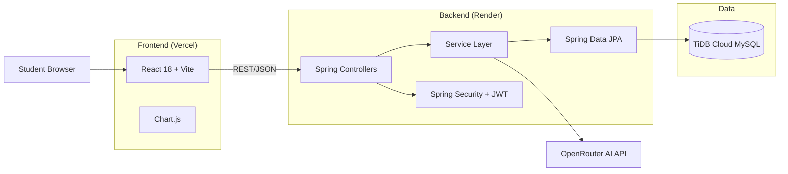

# 🎓 AI Study Assistant

A production-ready, full-stack AI-powered learning platform. Upload lecture notes (text or PDF) → the OpenRouter AI generates summaries, flashcards, and MCQ quizzes → take timed quizzes → track progress with learning analytics and spaced-repetition flashcards.


## ✨ Features

- **📝 Note Management** — Paste text or upload PDF files (PDFBox + Apache POI)
- **🤖 AI-Powered Generation** — OpenRouter AI creates summaries, flashcards, and MCQ quizzes with a single click
- **🃏 Spaced-Repetition Flashcards** — Leitner box system (5 boxes, doubling intervals) that intelligently schedules card reviews
- **📋 Timed Quizzes** — Countdown timer with auto-submit, detailed answer breakdown, retake support
- **📊 Learning Analytics** — Topic-wise performance, cumulative score trends, weakest/strongest topic detection, and personalized study recommendations
- **📈 Progress Tracking** — Chart.js line graphs showing score trends over time
- **🔒 Secure Auth** — JWT-based authentication with BCrypt (cost 12), ownership-level authorization (no IDOR)
- **📖 API Documentation** — Swagger UI with OpenAPI 3.0
- **📱 Responsive UI** — Mobile-first with collapsible sidebar, error boundaries, and empty states

## 🏗️ Architecture



## 🛠️ Tech Stack

| Layer | Technology |
|-------|-----------|
| Backend | Java 17, Spring Boot 3.4, Spring Security, Spring Data JPA |
| Database | TiDB Cloud (MySQL 8 compatible), H2 for tests |
| AI | OpenRouter (OpenAI-compatible chat completions) |
| Frontend | React 18, Vite, Chart.js, react-router-dom |
| Docs | springdoc-openapi (Swagger UI) |
| CI/CD | GitHub Actions |
| Deploy | Render (backend), Vercel (frontend) |

## 🚀 Quick Start (Local)

### Prerequisites

- Java 17+
- Node.js 18+
- An OpenRouter API key: https://openrouter.ai/keys

### 1. Configure environment variables

Create `backend/src/main/resources/application-local.properties` (gitignored):

```properties
# MySQL or TiDB connection
spring.datasource.url=jdbc:mysql://localhost:3306/study_assistant_db?createDatabaseIfNotExist=true
spring.datasource.username=root
spring.datasource.password=your_password

# Secrets
app.jwt.secret=some-long-random-secret-at-least-32-chars
app.openrouter.api.key=sk-or-v1-your-openrouter-key
```

### 2. Start the backend

```bash
cd backend
mvn spring-boot:run -Dspring-boot.run.profiles=local
```

### 3. Start the frontend

```bash
cd frontend
npm install
npm run dev
```

### 4. Access the app

| Service | URL |
|---------|-----|
| Frontend | http://localhost:5173 |
| Backend API | http://localhost:8080 |
| Swagger UI | http://localhost:8080/swagger-ui.html |

## 🧪 Testing

The backend test suite uses an in-memory H2 database (test profile), so tests never touch a real database:

```bash
cd backend
mvn test
```

Coverage includes: authentication flows, JWT security, **ownership/IDOR protection** (cross-student access to notes, quizzes, and flashcards is rejected), AI generation service, and quiz scoring.

## 📡 API Reference

### Authentication
| Method | Endpoint | Description |
|--------|----------|-------------|
| POST | `/api/auth/register` | Register new student |
| POST | `/api/auth/login` | Login, returns JWT |

### Notes
| Method | Endpoint | Description |
|--------|----------|-------------|
| POST | `/api/notes/text` | Create note from pasted text |
| POST | `/api/notes/upload` | Create note from PDF/DOCX |
| GET | `/api/notes` | List student's notes (paginated) |
| GET | `/api/notes/{id}` | Get a note (owner only) |
| GET | `/api/notes/{id}/study-materials` | Get summary, flashcards, quiz (owner only) |
| DELETE | `/api/notes/{id}` | Delete a note |

### AI Study Generation
| Method | Endpoint | Description |
|--------|----------|-------------|
| POST | `/api/study/generate` | Generate summary, flashcards & quiz (owner only) |

### Quiz
| Method | Endpoint | Description |
|--------|----------|-------------|
| POST | `/api/quiz/attempt` | Submit answers, get score + breakdown |
| GET | `/api/quiz/history` | Attempt history |

### Flashcards (Spaced Repetition)
| Method | Endpoint | Description |
|--------|----------|-------------|
| POST | `/api/flashcards/review` | Record review — moves card through Leitner boxes |
| GET | `/api/flashcards/due` | Cards due for review |

### Analytics & Progress
| Method | Endpoint | Description |
|--------|----------|-------------|
| GET | `/api/analytics` | Topic performance, trends, recommendations |
| GET | `/api/progress` | Score history per topic |
| GET | `/api/dashboard/stats` | Dashboard statistics |

## 🗄️ Database Schema

```
students ──┬── notes ──┬── flashcards (box_level, next_review_date)
           │           └── quizzes ── quiz_questions
           └── quiz_attempts ──────── quizzes
```

- **students**: id, name, email, password (BCrypt), role, created_at
- **notes**: id, student_id, title, content, summary, created_at
- **flashcards**: id, note_id, question, answer, box_level, next_review_date
- **quizzes**: id, note_id, title, created_at
- **quiz_questions**: id, quiz_id, question_text, options A-D, correct_option
- **quiz_attempts**: id, student_id, quiz_id, score, total_questions, percentage, attempted_at

## ☁️ Deployment (Production)

The app deploys to **Render** (backend), **Vercel** (frontend), and **TiDB Cloud** (database):

1. **TiDB Cloud** — create a free cluster, note the host, username, and password, and add the Render app's IP (or `0.0.0.0/0`) to the allowlist.
2. **Render** — set env vars: `SPRING_DATASOURCE_URL`, `SPRING_DATASOURCE_USERNAME`, `SPRING_DATASOURCE_PASSWORD`, `JWT_SECRET`, `OPENROUTER_API_KEY`, `ALLOWED_ORIGIN`. The app refuses to start if `JWT_SECRET` is missing.
3. **Vercel** — set `VITE_API_URL` to the Render backend URL.

## 🤖 The AI Pipeline

1. User uploads a note (text or PDF)
2. Backend extracts the content and sends a structured prompt to OpenRouter
3. The AI returns strict JSON (enforced via `response_format`)
4. Backend validates and parses the response, persists summary/flashcards/quiz, and returns a typed DTO
5. Generation is wrapped in a transaction and retried on transient failures

## 📸 Screenshots

> Add screenshots here: dashboard, study materials, quiz, flashcards, analytics.

## 🔐 Security Notes

- Passwords hashed with BCrypt (cost factor 12)
- JWT with HS256, 24h expiry, secret injected via environment
- **Ownership checks on every resource endpoint** — verified by unit tests (no IDOR)
- 401 vs 403 semantics: unauthenticated → 401, authenticated-but-forbidden → 403
- Secrets never committed — all config via environment variables
